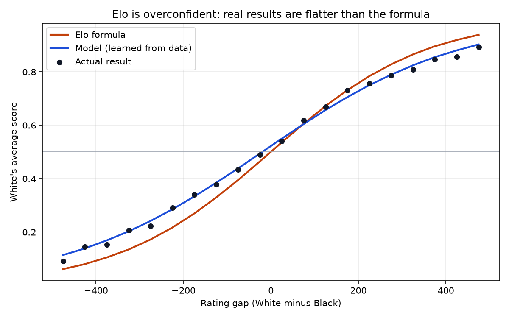
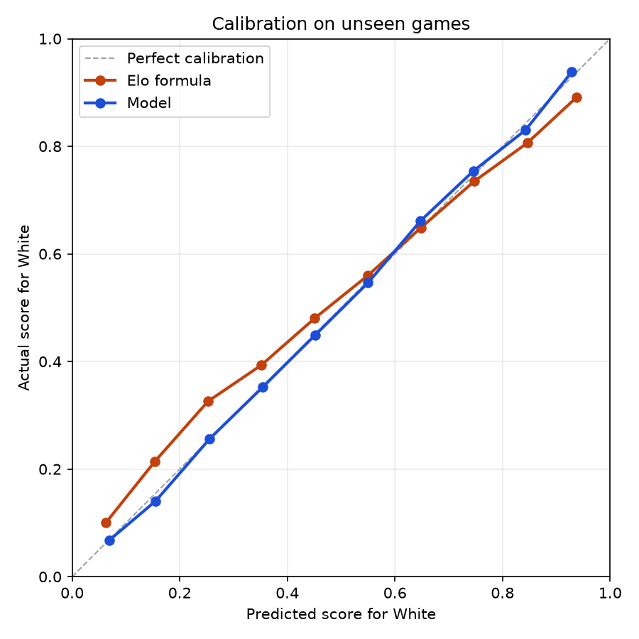

# Can Machine Learning Beat the Elo Formula?

Predicting chess results from **120,934 Lichess games** with SQL (DuckDB) and scikit-learn, then testing the findings on my own **13,194 Chess.com games**.

**Short answer: yes, a little, and the reason is the interesting part.** The Elo formula is *overconfident*: in real games, a rating gap matters only about **78%** as much as the formula assumes, and it ignores White's first-move advantage (worth about **19 rating points**). A model that learns those two numbers from data beats the Elo formula on games it has never seen, fixes its calibration at the extremes, and the correction still helps on a different site, 13 years later.



---

## Key results

| | Finding |
|---|---|
| **Elo is overconfident** | Refit to real games, the rating-gap slope is **0.00451** vs. Elo's fixed **0.00576** (78%). Underdogs score more than Elo predicts; favorites score less. |
| **White's edge** | The first move is worth about **19 rating points**. Elo assumes zero. |
| **Beats Elo on unseen games** | Log loss **0.6132** vs. Elo's **0.6174** (+0.7%) on 24,187 later games held out by time. |
| **Fixes calibration** | When Elo predicts an underdog scores 15%, they actually score 21%. The model's predictions are within 1–2 points in every range. |
| **Simple wins** | Gradient boosting with six features did *not* beat the one-feature model (0.6135). The rating gap carries nearly all the signal. |
| **Generalizes** | On my own Chess.com games (2021–2026), the Lichess-trained model still beats Elo (log loss 0.6837 vs. 0.6866). |



---

## The key idea: Elo is a logistic regression

The Elo expected score is

```
E = 1 / (1 + 10^(-gap / 400))
```

Since 10 = e^(ln 10), this is exactly a **logistic regression** on the rating gap, with the slope **fixed** at ln(10)/400 ≈ 0.00576 and the intercept **fixed** at 0 (no color advantage). So "can ML beat Elo?" becomes a precise question: *what happens if those two numbers are learned from data instead of assumed?*

---

## Data

**Lichess, January 2013** ([database.lichess.org](https://database.lichess.org)): every rated game played that month, 121,332 games (17.8 MB compressed PGN). Only the game headers are used: ratings, result, time control, and opening.

Cleaning removed 398 games (0.3%), every one accounted for:

| Reason | Games |
|---|---|
| Missing or non-numeric rating | 218 |
| Correspondence games (no clock, time control `-`) | 266 |
| Both (overlap) | −86 |
| **Total removed** | **398** |

**Avoiding data leakage:** headers known only *after* a game (`Termination`, `WhiteRatingDiff`/`BlackRatingDiff`) are never used as features.

**My Chess.com games** ([Chess.com Published-Data API](https://www.chess.com/news/view/published-data-api)): all 13,198 of my rated standard-chess games, February 2021 to October 2026 (mostly rapid).

---

## Method

| Step | File | What it does |
|---|---|---|
| 1. Download | `download_data.py` | Downloads one month of Lichess games (reproducible, skips if already present) |
| 2. Load | `build_db.py` | Streams the compressed PGN, keeps headers only, loads 121,332 games into DuckDB in ~4 seconds |
| 3. Explore | `explore.py` | SQL questions before cleaning (missing data, terminations, time controls, Elo vs. actual) |
| 4. Clean | `sql/clean.sql`, `clean_data.py` | Typed columns, time classes (Lichess rule: base + 40 × increment), opening families, target score |
| 5. Baselines | `common.py` | Time-based split, Elo formula, log loss, Brier score, calibration tables |
| 6. Models | `train_logistic.py` | Logistic regression: Elo refit to data, plus a richer variant |
| 7. Non-linear | `train_boosting.py` | Gradient boosting, per-time-control analysis, permutation importance |
| 8. Charts | `charts.py` | The two charts above |
| 9. My games | `fetch_my_games.py`, `analyze_my_games.py` | Applies everything to my Chess.com history |

**Evaluation choices**

- **Split by time, not randomly:** train on the first 80% of the month, test on the last 20% (24,187 games). This mimics predicting future games.
- **Probability metrics:** log loss and Brier score, not accuracy. Accuracy can't tell a 51% prediction from a 99% one.
- **Draws as half a point:** each draw is trained as half a win plus half a loss (sample weights), so the model predicts *expected score*, exactly what Elo predicts. Draws are rare online (3.3%).
- **Baselines:** a naive model (always predict White's average score) and the Elo formula.

---

## Results

### Scoreboard (24,187 unseen test games, lower is better)

| Model | Log loss | Brier | vs. Elo |
|---|---|---|---|
| Naive (ignores ratings) | 0.6914 | 0.2411 | −12.0% |
| Elo formula | 0.6174 | 0.2062 | — |
| **Logistic regression (rating gap only)** | **0.6132** | **0.2049** | **+0.7%** |
| Logistic regression (+ average rating, time control) | 0.6133 | 0.2049 | +0.7% |
| Gradient boosting (6 features) | 0.6135 | 0.2050 | +0.6% |

A 0.7% gain sounds small, but chess results are noisy: most of the log loss is randomness no model can remove. Ratings alone take it from 0.691 to 0.617.

### By time control

| Time control | Rating gap strength (Elo = 100%) | White's edge | Elo log loss | Model log loss |
|---|---|---|---|---|
| Bullet | 82% | 17 pts | 0.5886 | 0.5880 |
| Blitz | 78% | 26 pts | 0.6156 | 0.6124 |
| Rapid | 75% | 13 pts | 0.6382 | 0.6309 |
| Classical | 76% | 18 pts | 0.6824 | 0.6622 |

Elo is overconfident in every time control, **least in bullet and most in classical**. A plausible explanation (a hypothesis, not tested here): players play far more bullet games, and ratings built from more games are more reliable. The classical test set is small (479 games).

### Feature importance

Scrambling `rating_diff` worsens log loss by **0.16**; every other input (time control, increment, average rating, opening group) by **0.0004 or less**. Once ratings are known, the opening tells you almost nothing about who wins.

---

## Applying it to my own games

### A data bug, caught and fixed

My first analysis said a rating gap matters **301%** as much as Elo assumes, which is implausible. I tested whether the Chess.com API records ratings *before* or *after* each game:

| My rating change, grouped by the result of… | Loss | Draw | Win |
|---|---|---|---|
| **this** game | −8.4 | +0.4 | +8.1 |
| the **previous** game | −0.0 | +1.7 | −0.1 |

The API records ratings **after** the game, so the raw rating gap already contained the result (data leakage). I rebuilt pre-game ratings: my rating before a game is my rating after my previous game in the same time control, and my opponent's is adjusted by the opposite of my change (an approximation).

### Findings (13,194 games)

- **My rating is accurate:** I scored 0.508; Elo expected 0.509.
- **The Lichess correction transfers:** the Lichess-trained model beats Elo on my games (log loss 0.6837 vs. 0.6866).
- **Same overconfidence pattern:** against opponents 50–200 points higher I score **+0.059** above Elo's prediction; against opponents 50–200 points lower, **−0.052** below it.
- **White's edge:** about **24 rating points** for me (0.528 as White, 0.488 as Black).
- **Openings:** my best relative to my rating is the **Giuoco Piano** (+0.034 over 1,525 games). The Sicilian Defense (−0.019) and Bishop's Opening (−0.018) are slightly below, but within the range luck alone could produce.

---

## Limitations

- **One month of 2013 Lichess data.** The player pool was smaller and the site different from today; a recent month would be a stronger test.
- **Glicko-2, not Elo.** Both sites use Glicko-2 ratings; the Elo expected-score formula is the classic baseline, not the formula either site uses internally.
- **Provisional ratings aren't marked** in the 2013 headers, so new players' noisy ratings are included.
- **Single time-based split, no confidence intervals.** Bootstrapping the test set would show how stable the 0.7% gain is.
- **My-games analysis:** opponents' pre-game ratings are approximated, which adds noise to the rating gap. Noise in an input flattens a fitted slope (regression dilution), so my personal slope (59% of Elo) likely understates the true value. Chess.com's even pairing (10,223 of my games within 50 points) also leaves few large gaps to learn from.
- **Chess.com and Lichess ratings are on different scales**, so applying the Lichess model to Chess.com tests whether the *shape* of the correction transfers, not the exact numbers.

## Next steps

- Repeat on several recent Lichess months to check the finding over time.
- Add players' game counts (rating reliability) as a feature to test the bullet-vs-classical hypothesis.
- Bootstrap confidence intervals for every metric.

---

## How to run

Requires Python 3.10+ (tested on 3.13, Windows 11). No API keys needed.

```powershell
git clone https://github.com/Hector521/chess-elo-vs-ml.git
cd chess-elo-vs-ml
py -m venv .venv
.venv\Scripts\Activate.ps1          # macOS/Linux: source .venv/bin/activate
pip install -r requirements.txt

python download_data.py             # 17.8 MB download
python build_db.py                  # headers -> DuckDB
python explore.py                   # SQL exploration
python clean_data.py                # runs sql/clean.sql
python common.py                    # split + baselines
python train_logistic.py            # Elo vs. logistic regression
python train_boosting.py            # boosting, time controls, importance
python charts.py                    # docs/*.png

# Optional: analyze any Chess.com player's games (set USERNAME in fetch_my_games.py)
python fetch_my_games.py
python analyze_my_games.py
```

## Tech stack

Python 3.13 · DuckDB (SQL) · pandas · scikit-learn (logistic regression, gradient boosting, permutation importance) · matplotlib · python-chess · zstandard · Chess.com Published-Data API
